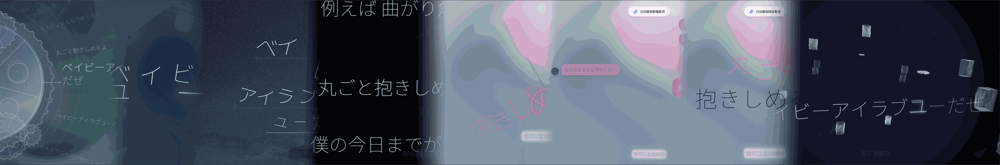
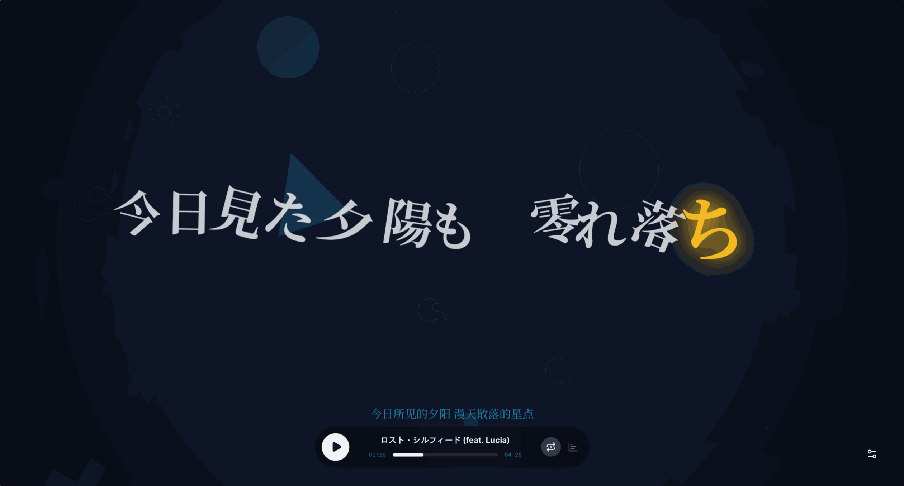
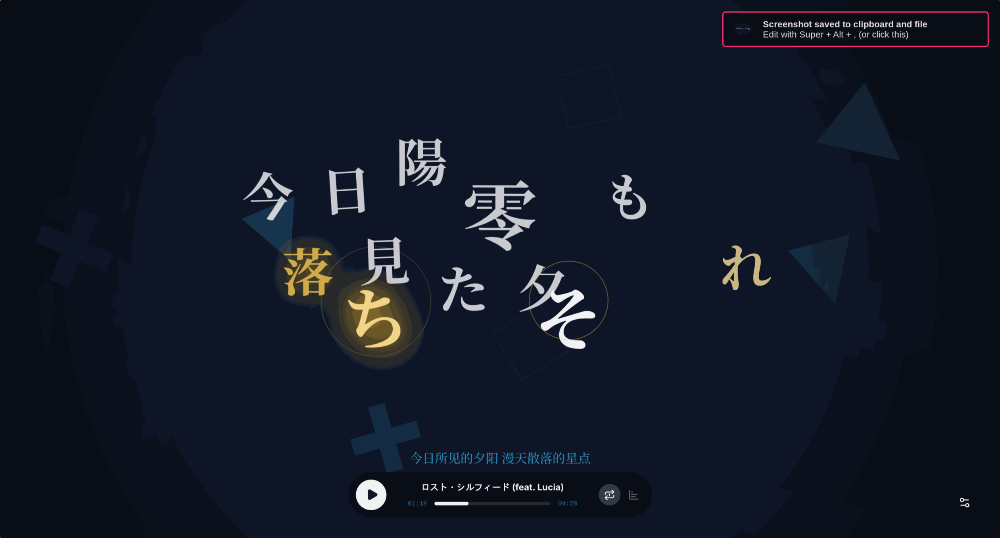
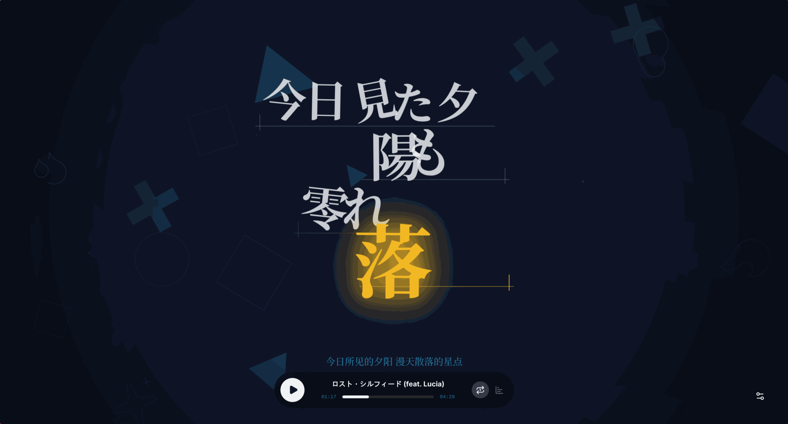
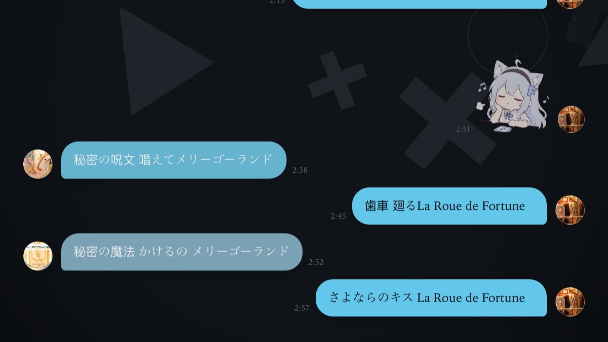
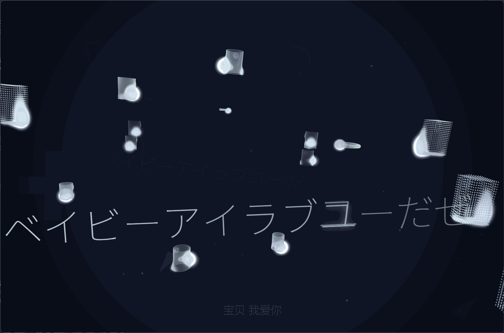

<p align="center">
  
</p>

<div align="center">
<a href="https://trendshift.io/repositories/71740?utm_source=repository-badge&amp;utm_medium=badge&amp;utm_campaign=badge-repository-71740" target="_blank" rel="noopener noreferrer"></a>

# Folia

Lyrics Reimagined // 辞曲新境

[简体中文](README.md) | [English](README.en.md)

[](https://github.com/chthollyphile/folia-major/releases)
[](https://github.com/chthollyphile/folia-major/blob/main/LICENSE)
[](https://github.com/chthollyphile/folia-major/stargazers)
[](https://nodejs.org/)
[](https://deepwiki.com/chthollyphile/folia-major)
[](https://discord.gg/dMDBTHxeKd)
[](CONTRIBUTORS.md)

[Get Folia](#get-folia)
·
[Deploy to Vercel](https://vercel.com/new/clone?repository-url=https://github.com/chthollyphile/folia-major)
·
[User Guide](https://folia-site.cielaniska.top/guide/)
·
[Technical Notes](docs/technical.md)

</div>

## About

Folia is an online music player built around full-screen, immersive lyrics. It supports NetEase Cloud Music, Kugou, QQ Music, Navidrome, and local music libraries; the desktop app also supports Bodian Music, YouTube Music, and Spotify. Smart lyric matching, AI-generated color themes, and a range of full-screen lyric animations make listening feel different.

Folia ships as an Electron desktop app for Windows, macOS, and Linux, and as a Node.js web app you can deploy to many platforms.

To use Folia on a phone or in a browser, [deploy the web app to Vercel in one click](https://folia-site.cielaniska.top/guide/deploy-vercel), or deploy it yourself to any platform that runs Node.js.

## Quick download

> [!TIP]
> - **GitHub**: [Latest Release](https://github.com/chthollyphile/folia-major/releases/latest) has installers for Windows, macOS, and Linux.
> - **Cloud drives** (faster in mainland China): [Quark](https://pan.quark.cn/s/6e4c6fa3bc6f) · [Baidu](https://pan.baidu.com/s/1f0x3g-8PMcNCO-TJ5z1rPw?pwd=flia) (code `flia`). Stable installers for Windows and Apple silicon only.
>
> For other options (web deployment, Docker, AUR, Flatpak, mobile), see [Get Folia](#get-folia) below.

## Showcase



### Demo videos

https://github.com/user-attachments/assets/af806cf1-f67f-4b88-b2e7-57db507e9e81

https://github.com/user-attachments/assets/fd27f4f0-64b9-4c57-8c3b-10df767f934b

https://github.com/user-attachments/assets/704f195a-2194-434b-86e8-8f36290e5cc4

### Selected styles

<table>
  <tr>
    <td width="50%">
      
    </td>
    <td width="50%">
      
    </td>
  </tr>
  <tr>
    <td align="center"><strong>Fume</strong></td>
    <td align="center"><strong>Luminous</strong></td>
  </tr>
  <tr>
    <td width="50%">
      
    </td>
    <td width="50%">
      
    </td>
  </tr>
  <tr>
    <td align="center"><strong>Mindscape</strong></td>
    <td align="center"><strong>Partita</strong></td>
  </tr>
  <tr>
    <td width="50%">
      
    </td>
    <td width="50%">
      
    </td>
  </tr>
  <tr>
    <td align="center"><strong>Cappella</strong></td>
    <td align="center"><strong>Tilt</strong></td>
  </tr>
    <tr>
    <td width="50%">
      
    </td>
    <td width="50%">
      
    </td>
  </tr>
  <tr>
    <td align="center"><strong>Diorama</strong></td>
    <td align="center"><strong>Pendolo</strong></td>
  </tr>
</table>

Each lyric animation has its own typography, mood, and tunable parameters, giving full-screen lyrics the richness of a lyric video while staying responsive to any window size.

## Features

| Feature | Description |
| --- | --- |
| Online search and playback | Search for songs, artists, or albums and play them; covers and lyrics load automatically. |
| Local music | Import local audio files. Folia stores the index locally and never uploads file contents. See [Local Library Management](docs/local-library-management.md) (Chinese). |
| Smart lyric matching | Local songs are matched to online lyrics and covers automatically; you can correct matches by hand. |
| Local lyric files | Loads `.lrc`, `.vtt`, `.ttml`, `.qrc`, `.yrc`, and `.krc` files with the same name in the same folder, as well as embedded LRC lyrics. Supports the enhanced word-by-word formats produced by LDDC. |
| Now Playing integration | Connects to a local [Now Playing](https://github.com/Widdit/now-playing-service/) service to take song, timeline, and lyric data from external players and drive Folia's stage view and full-screen lyrics. |
| AI themes | Generates immersive backgrounds and visual parameters from a song's mood and lyrics. |
| Multi-platform | Deploy as a web app or install the packaged desktop app. |
| Mods (experimental) | On desktop, Folium mods can add lyric animations, backgrounds, player-page layers, commands, and more. Install officially verified mods from the [mod market](https://folium-compound.cielaniska.top). See [Mods](#mods-folium-v1x). |

## Get Folia

The desktop app bundles both frontend and backend, so it works right after install.

### One-click deployment

To put the web app online quickly, follow the [Vercel deployment guide](https://folia-site.cielaniska.top/guide/deploy-vercel).

[](https://vercel.com/new/clone?repository-url=https://github.com/chthollyphile/folia-major)

Folia also deploys to Cloudflare in one click; adapt the Vercel guide accordingly.

[](https://deploy.workers.cloudflare.com/?url=https://github.com/chthollyphile/folia-major)

On Vercel and Cloudflare, QQ Music no longer needs a separate, always-on API instance: set `VITE_QQ_API_BASE` to `/api/qq` and add a `QQ_SESSION_SECRET` (a server-side secret, **without the `VITE_` prefix**). This setup supports login by scanning a QR code with WeChat or mobile QQ (mobile QQ requires qq-music-api 3.3.3 or later), and you must log in before playback. On Cloudflare you can also bind a Durable Object so QQ QR login uses a long-lived connection and gains QR login with the QQ Music app. For full steps, platform differences, and troubleshooting, see the [QQ Music deployment guide](docs/qq-music-deployment.md) (Chinese).

Self-hosters can use the [Docker Compose full-stack deployment](deploy/docker/README.md). Access to local music folders requires a trusted HTTPS secure context; the deployment docs cover NAS reverse proxies and certificate requirements.

### Direct download

- **Windows / macOS / Linux**: Download the latest installers from the [Releases page](https://github.com/chthollyphile/folia-major/releases/latest).
- **Arch Linux**: Install [folia-major-bin](https://aur.archlinux.org/packages/folia-major-bin) from the AUR.
- **Flatpak**: A community-maintained third-party Flatpak is available on [Flatpark](https://flatpark.org/apps/top.izuna.foliamajor/).
- **Android**: Third-party community ports are listed under [Mobile](#mobile) below.

> [!IMPORTANT]
> If GitHub Releases is slow from mainland China, download from [Quark](https://pan.quark.cn/s/6e4c6fa3bc6f) or [Baidu](https://pan.baidu.com/s/1f0x3g-8PMcNCO-TJ5z1rPw?pwd=flia) instead. These links host stable installers for Windows and Apple silicon only.

For Linux packages, the Wayland / Hyprland remote control window, and other desktop details, see [Technical Notes](docs/technical.md) (Chinese).

### Mobile & Native Android App

| Option | Details |
| --- | --- |
| **Native Android APK (Built-in)** | The repository includes a first-party Capacitor 8 + AndroidX Media3 native Android project (`android/`) featuring an OLED-friendly mobile-first UI, persistent SAF local folder permissions, lock-screen & background playback, full Folia visualizer support, and shaped Arabic RTL lyrics. |
| **PWA (Web deployment)** | Deploy the web or self-hosted version, then add it to your home screen from Chrome for Android or iOS Safari to use it as a PWA. |
| **Community ports (Android)** | [maimai993/folia-sonnet](https://github.com/maimai993/folia-sonnet) · [whycfawa/folia-android](https://github.com/whycfawa/folia-android) |

#### Android Setup, Build Commands, Permissions & APK Installation

1. **Prerequisites**:
   - Node.js >= 22 (Node.js 24 recommended)
   - JDK 21 (required by Android Gradle Plugin 8.13)
   - Android SDK (`compileSdkVersion = 36`, `targetSdkVersion = 36`, `minSdkVersion = 24`)

2. **Build Commands**:
   ```bash
   # 1. Build the web bundle for Android (disables web PWA precache SW so Capacitor bridge injects cleanly)
   npm run build:android:web

   # 2. Sync web assets into android/app/src/main/assets/public
   npm run android:sync

   # 3. Build web assets + sync Android in one step
   npm run build:android

   # 4. Assemble the installable Debug APK via Gradle (requires JDK 21 and Android SDK)
   npm run android:apk:debug
   # Or run Gradle directly:
   cd android && ./gradlew assembleDebug
   ```

3. **APK Output Location & GitHub Actions Artifact**:
   - Local Gradle build output: `android/app/build/outputs/apk/debug/app-debug.apk`
   - GitHub Actions CI artifact: Run or trigger `.github/workflows/android-debug-apk.yml` (**Build Android Debug APK**) and download the **`folia-android-debug-apk`** artifact containing `app-debug.apk`.

4. **Installing the Debug APK on Android**:
   - **Via ADB**:
     ```bash
     adb install -r android/app/build/outputs/apk/debug/app-debug.apk
     ```
   - **Direct on-device install**: Copy `app-debug.apk` to your phone, tap it in the Files app, and allow installation from unknown sources if prompted.

5. **Storage Permissions & Background Playback**:
   - **Storage Access Framework (SAF)**: Uses `ACTION_OPEN_DOCUMENT_TREE` and `ACTION_OPEN_DOCUMENT` with `takePersistableUriPermission` so selected music folders and sidecar lyric files (`.lrc`, `.ttml`, `.vtt`, `.qrc`, `.yrc`, `.krc`) persist across app restarts without re-importing. Also declares `READ_MEDIA_AUDIO` (Android 13+) and `READ_EXTERNAL_STORAGE` (Android <= 12) compatibility permissions.
   - **Background & Lock-Screen Playback**: Runs `FoliaPlaybackService` (`FOREGROUND_SERVICE_MEDIA_PLAYBACK`) with an AndroidX Media3 `MediaSession`, supporting system media notifications, lock-screen seeking, Bluetooth/headset controls, and AudioFocus ducking/interruption handling.
   - **Mobile GPU & Battery Optimization**: Caps mobile Canvas DPR to `1.5x` and Pixi render-target resolution to prevent oversized power-of-two FBO allocations on 1440p OLED screens, and automatically suspends WebGL/Canvas animation loops when the screen is locked or when browsing the library.

6. **Known Limitations on Android**:
   - Desktop-only Electron capabilities (desktop wallpaper mode, click-through windows, global OS hotkeys, native FFmpeg MP4 export, Koffi native bindings, and local Node proxy processes) are not available on Android.

## Documentation and development

For the full user guide, visit [Folia Guide](https://folia-site.cielaniska.top/guide/).

Deployment, environment variables, local development, the Stage API, common scripts, and the tech stack are covered in [Technical Notes](docs/technical.md) (Chinese).

Before contributing, read the [Contributing Guide](CONTRIBUTING.en.md).

## Mods (Folium v1.x)

> [!NOTE]
> Mods are experimental, available in the desktop app only, and off by default. Turn them on in **Settings → Mods → Mod system**.

Folium is Folia's mod platform. Mods can add lyric animation modes and background types, overlay content on the player page, add buttons and markers to the progress bar, register commands and settings sections, rewrite lyrics before they are displayed, and use native capabilities such as ffmpeg through a Node entry point. Mods run as trusted code: you confirm each mod in a native window before it is enabled, and confirm again after its files change.

- **Mod market**: [folium-compound.cielaniska.top](https://folium-compound.cielaniska.top) hosts official mods and reviewed community mods. Download the zip and drag it into the Mods panel to install.
- **Verification**: Every mod in the market carries a Folium signature and shows as **Verified** after install. Early-access mods that passed only the security review show as **Preview**. Third-party mods without a signature show as **Unverified** and still work.
- **Developing and contributing**: The [mod development and contribution guide](docs/folium/contributing.md) walks from your first mod and local debugging through submitting to the market, review and signing, and publishing updates.
- **API reference**: The [Folium API reference](docs/folium/api.md) is generated from the contract file and organized by registries, contexts, events, and services.
- **Platform spec**: The [Folium spec](mods/README.md) covers manifest fields, permissions, registry semantics, events, the security model, and versioning.
- **Example mods**: The repository's [`mods/`](mods/) folder covers lyric animations, tuning, the progress bar, player-page layers, and transparent video export.

## Sync Server

Folia offers an optional official sync server, `sync-server`, that syncs appearance settings and the AI theme library across devices. You host it yourself; it suits anyone who wants their color themes on every device.

Deployment options:

- **Cloudflare Workers / D1**: Serverless, no servers to maintain. Recommended.
  [](https://deploy.workers.cloudflare.com/?url=https://github.com/chthollyphile/folia-major/tree/main/sync-server)
- **Docker**: See the [Docker deployment folder](deploy/docker/README.md) for the image and Compose setup.
- **Self-hosted Node.js**: Uses SQLite; suits local machines or environments where Docker is inconvenient.

For environment variables, token setup, and deployment steps, see the [Sync Server deployment guide](https://folia-site.cielaniska.top/guide/deploy-sync). Once deployed, enter the server URL and `SYNC_TOKEN` in **Settings → Connections** to turn on sync.

## Local music and matching

Folia reads audio metadata plus lyrics and covers from the same folder, and can fill in song details from NetEase Cloud Music, QQ Music, or Kugou. Automatic matching tries NetEase, then QQ, then Kugou. When a match is wrong, you can pick another candidate, restore the local data from the first import, or merge and split artist and album entries.

For importing, rescanning, matching, entry editing, playlists, caching, and troubleshooting, see [Local Library Management](docs/local-library-management.md) (Chinese).

## Community

Join the Discord to chat and get help.

[](https://discord.gg/dMDBTHxeKd)

## Contributors

Thanks to everyone who has filed issues, reported bugs, suggested ideas, tested, or written code. Contributions are tracked under the all-contributors specification.

The list is long, so see [Contributors](CONTRIBUTORS.md).

## Legal and disclaimer

This project was developed with extensive AI assistance and may still contain subtle or hard-to-spot problems. We apologize for any inconvenience.

The project mainly showcases playback animation, interface design, and the engineering behind them. Copyright in the online streams, lyrics, album art, and other content shown in the app belongs to the respective rights holders.

This repository and its source code are for personal study, technical exchange, and non-profit testing only. Do not use them for commercial purposes. Users bear sole responsibility for any copyright dispute or other liability arising from distributing, modifying, or redistributing online resources; the developers accept no liability.

Please respect digital rights and support licensed music through official platforms whenever you can.

## Acknowledgements

Special thanks to these projects and resources:

- [chenmozhijin/LDDC](https://github.com/chenmozhijin/LDDC)
- [NeteaseCloudMusicApiEnhanced](https://github.com/NeteaseCloudMusicApiEnhanced/api-enhanced)
- [chenglou/pretext](https://github.com/chenglou/pretext)
- [MakcRe/KuGouMusicApi](https://github.com/MakcRe/KuGouMusicApi)
- [paper-design/shaders](https://github.com/paper-design/shaders)
- [yakult-green-tea/qq-music-api](https://github.com/yakult-green-tea/qq-music-api)

Folia uses the [Apple Music-like Lyrics TTML word-by-word lyrics database](https://github.com/amll-dev/amll-ttml-db) for high-quality lyric files. Thanks to its authors and contributors.

## License

Folia is open source under the `AGPL-3.0` license.
